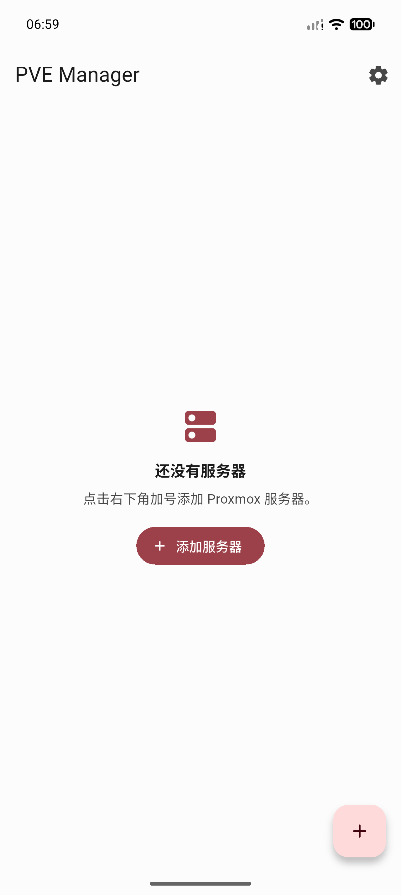
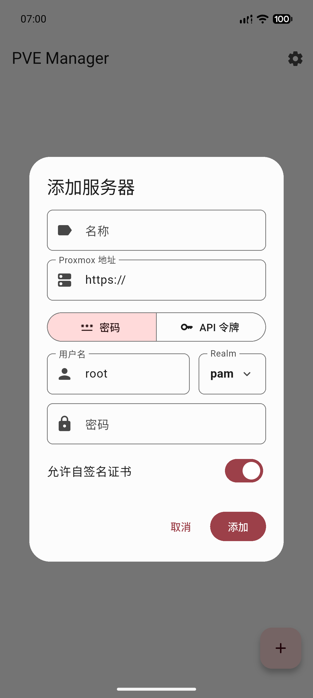
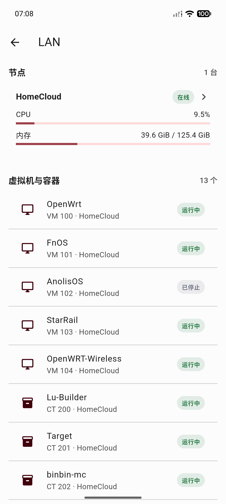
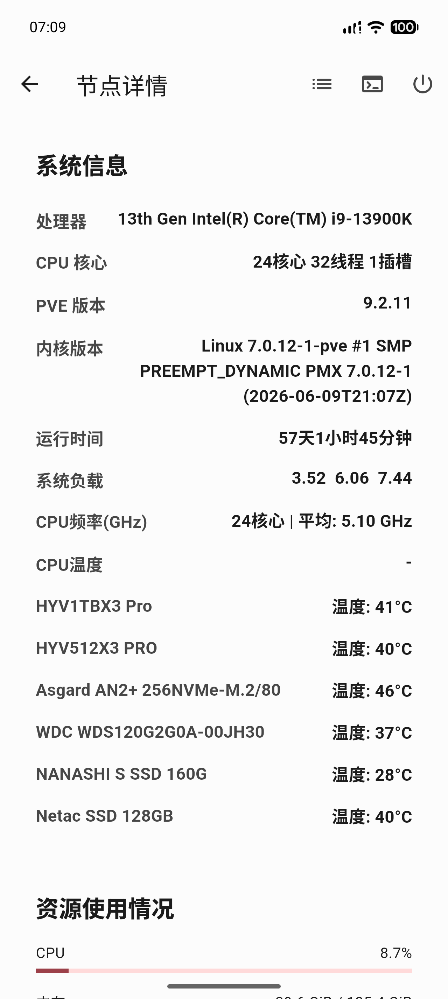
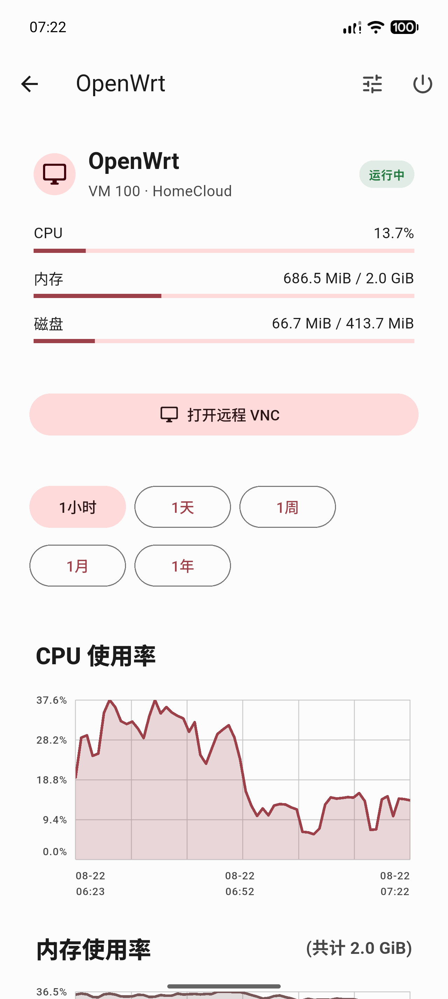
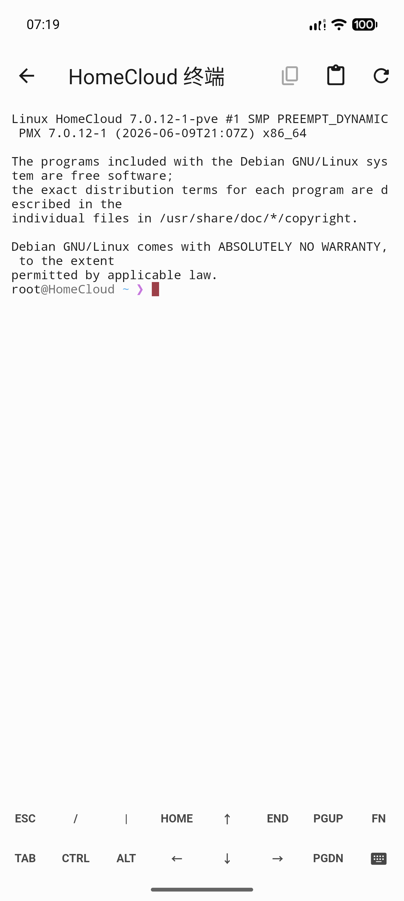

# PVE Manager

PVE Manager 是一款基于 Flutter 的 Proxmox VE 管理客户端，支持 Android 和
Windows。提供节点、虚拟机、容器和存储的集中管理，并内置适合日常运维的终端。

## 截图

| 服务器列表 | 添加服务器 |
| --- | --- |
|  |  |

| 服务器概览 | 节点详情 |
| --- | --- |
|  |  |

| 虚拟机详情 | 节点终端 |
| --- | --- |
|  |  |

## 功能

- 支持管理多个 Proxmox VE 服务器配置。
- 支持账号密码登录、PVE 二步验证和 API 令牌登录。
- 查看集群资源、节点、虚拟机、容器和存储。连接服务器后即可进入对应管理页面。
- 查看节点 CPU、内存、交换分区、根分区、系统负载、CPU 频率、CPU 温度和硬盘温度。
- 查看 CPU、内存、网络和磁盘使用情况历史图表。
- 启动、停止、关机和重启虚拟机、容器及节点。
- 查看虚拟机和容器硬件配置，并编辑受支持的配置项。
- 分页查看节点任务和系统日志，并支持刷新。
- 提供节点、虚拟机和容器终端，支持本地字符渲染、文本选择、复制、粘贴、系统键盘控制及
  JuiceSSH 风格快捷键。
- 支持自签名 Proxmox 证书和可配置的自动刷新间隔。
- 可从 GitHub Releases 检查 Android 和 Windows 的最新版本并下载更新。
- 使用 Material 3 设计，并在支持的平台使用动态取色。

## 许可证

本项目采用 [MIT License](LICENSE) 开源。
